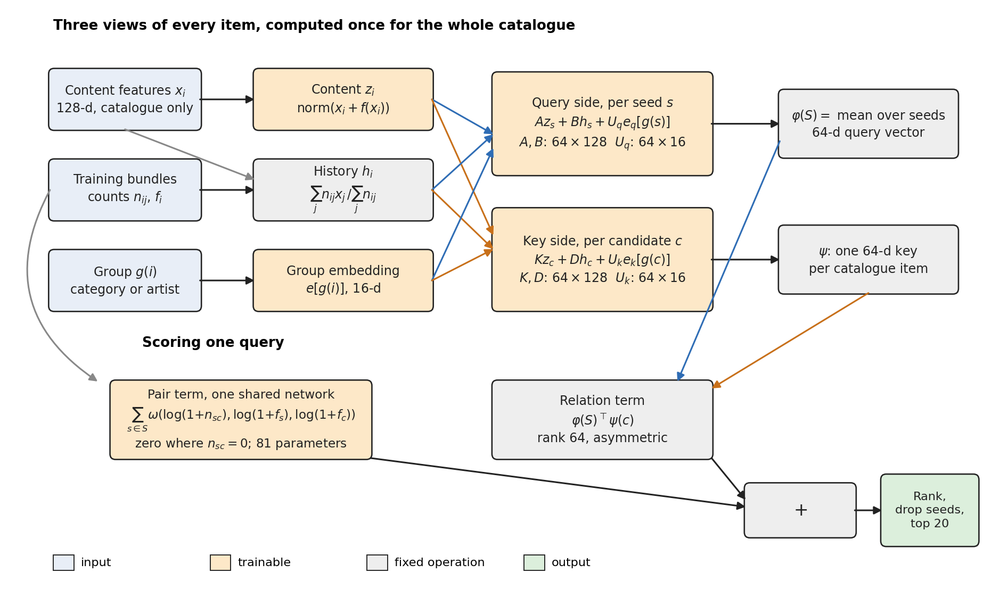
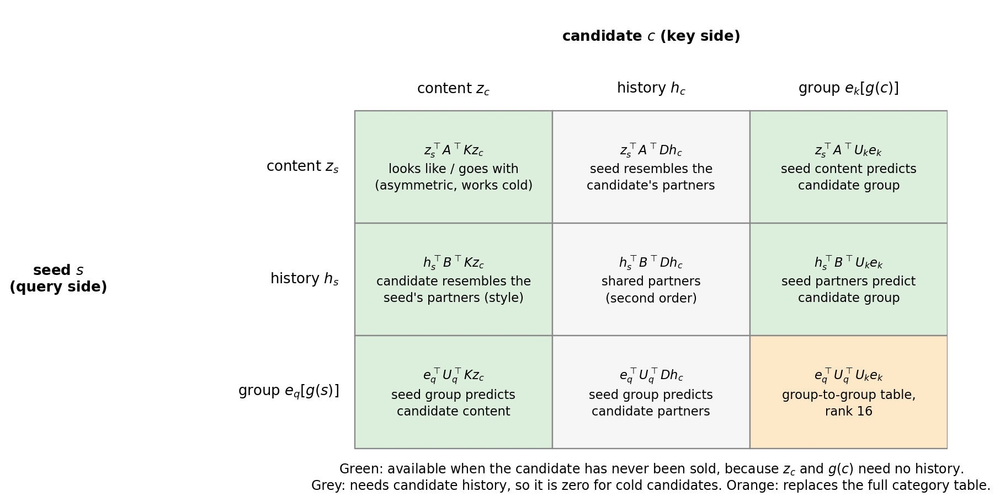
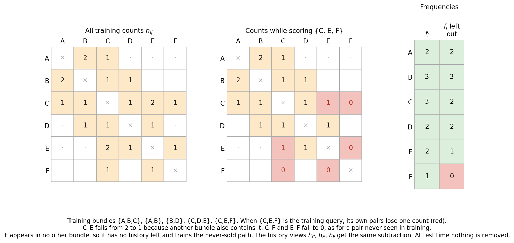
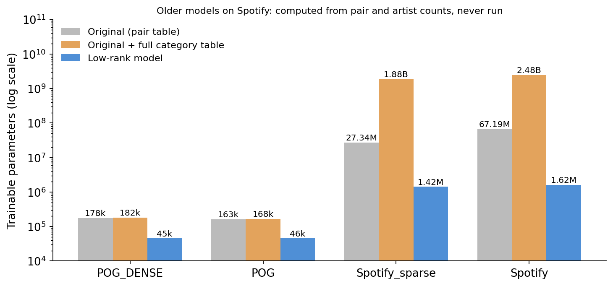

# Low-rank relation model

> Superseded by v3.1, the relation-family model: [`../neural_relations/ARCHITECTURE.md`](../neural_relations/ARCHITECTURE.md). This page describes v1 as tested under its own plan.

Code: [`model.py`](model.py) (`LowRankRelation`) and [`run.py`](run.py). The plan in `results/neural_lowrank/plan.json` was fixed before training. Figures come from [`figures/make_figures.py`](figures/make_figures.py).

This model replaces the earlier neural baseline, described in [`../neural_revision/ARCHITECTURE.md`](../neural_revision/ARCHITECTURE.md). It was designed from the bundle-completion problem and from the audit of that baseline (`results/neural_audit`), not adapted from a published architecture.

**In one line:** each item is described three ways (what it is, what it was bought with, which group it belongs to). One asymmetric rank-64 form compares a query's descriptions with every candidate's. One small shared network adds direct co-purchase evidence.

$$
s(c\mid S)\;=\;\underbrace{\varphi(S)^{\top}\psi(c)}_{\text{relation term}}\;+\;\underbrace{\sum_{s\in S}\omega\big(n_{sc},f_s,f_c\big)}_{\text{pair term}}
$$

$$
\varphi(S)=\frac{1}{|S|}\sum_{s\in S}\Big[A z_s + B h_s + U_q e_q[g(s)]\Big],\qquad
\psi(c)=K z_c + D h_c + U_k e_k[g(c)]
$$



*Figure 1. The top half builds three views of every item. The query side and the key side each project them into the same 64-dimensional space. The bottom half scores one query.*

## What the problem asks for

Four facts about the data drove the design.

1. **Targets are usually in a different group from the seeds.** In POG, 0.1% of validation targets share a seed's category, and in POG_DENSE none do. A symmetric similarity $v_s^{\top}v_c$ rewards a candidate for resembling the seed, which mostly means same category. Here the score should say what goes with the seed, which is not the same relation and need not be symmetric.
2. **Many targets have no history.** 59% of POG validation targets never appear in a training bundle. Any route to them must use content and group only.
3. **Co-purchase counts already carry most of what the old pair table learned.** In the audit, replacing the 138,000–153,000 learned pair weights with log counts cost almost nothing on validation (POG .0231 → .0229, POG_DENSE .2701 → .2646).
4. **Spotify is about 500 times larger.** It has up to 67 million observed pairs and 43,000–49,000 artists. A per-pair table or a full artist-by-artist table doesn't fit.

## The forward pass

### 1. Three views of each item

| View | Formula | Learned? | Available for a never-sold item? |
|---|---|---|---|
| Content $z_i$ | $\mathrm{normalize}(x_i + f(x_i))$, with $f$: 128 → 32 → 128 | Yes, the encoder $f$ | Yes |
| History $h_i$ | $\sum_j n_{ij}x_j \big/ \sum_j n_{ij}$ | No, fixed from training counts | No, it is 0 |
| Group $e[g(i)]$ | Row of a 16-column table for the item's category (POG) or artist (Spotify) | Yes | Yes |

$x_i$ is the same catalogue-only 128-dimensional projection as before: title, image and description vectors on POG, and audio on Spotify, reduced with SVD. $n_{ij}$ is the number of training bundles containing both $i$ and $j$. So $h_i$ is the count-weighted average content of item $i$'s past partners, which tells the model what $i$ is usually bought with. A group that never appears in training has its embedding held at zero. Otherwise it would only ever be pushed down as a negative.

### 2. Query and key projections

Each view is mapped into a shared 64-dimensional space, with different matrices on each side:

- query side: $A, B \in \mathbb{R}^{64\times128}$, $U_q\in\mathbb{R}^{64\times16}$
- key side: $K, D \in \mathbb{R}^{64\times128}$, $U_k\in\mathbb{R}^{64\times16}$

The query vector $\varphi(S)$ is the mean of the seeds' query vectors. Each catalogue item has one key $\psi(c)$, computed once per batch, or once for the whole evaluation.

### 3. The relation term is one bilinear form

Stack each item's views as $u_i=[z_i;\,h_i;\,e[g(i)]]$. Then $\varphi(S)^{\top}\psi(c)=\bar u_S^{\top}\,M\,u_c$, where $M = [A\;B\;U_q]^{\top}[K\;D\;U_k]$ has rank at most 64. Its nine blocks are the interactions the model can express:



*Figure 2. The 3×3 block structure of $M$. The six green and orange blocks still work when the candidate has never been sold.*

Three blocks matter most for the problems above:

- **Content × content, $A^{\top}K$.** Because $A\neq K$, this term can learn complementary pairs, such as a top suggesting a skirt, instead of just similarity. It is the main route to never-sold candidates.
- **History × content, $B^{\top}K$.** This asks whether the candidate looks like the seed's usual partners. It is the within-category style signal that the audit found missing on POG. The model computes it without being told what a category is: the seed's partners are mostly in the target's category, so resemblance to them is resemblance within that category.
- **Group × group, $U_q^{\top}U_k$.** This is a 16-rank category-to-category (or artist-to-artist) table, $E_q\,U_q^{\top}U_k\,E_k^{\top}$. It replaces the full table that closed most of the POG gap in the previous experiment. On POG, the full table had 5,184 entries. On Spotify it would have had 1.9–2.4 billion.

### 4. The pair term

$$
\omega(n_{sc},f_s,f_c)=\mathrm{softplus}\Big(\mathrm{MLP}\big(\log(1{+}n_{sc}),\,\log(1{+}f_s),\,\log(1{+}f_c)\big)\Big)\cdot[n_{sc}>0]
$$

$f_i$ is the number of training bundles containing $i$. The MLP is 3 → 16 → 1, so it has 81 parameters, and every observed pair shares it. The network decides how much evidence a pair count is worth relative to how common the two items are. The old model learned that separately for each pair. Pairs never seen in training contribute exactly 0, as before.

To compute it, the model looks up each seed's partners in a sorted list of observed pairs. The cost per query is the total number of seed partners. Nothing of size batch × all pairs is ever built, which is what made the old model unworkable on Spotify.

## Training: leave-one-out



*Figure 3. When a training bundle is the query, its own contribution to every count is subtracted first.*

The old model had a mismatch between training and test. During training, a seed and its hidden target always formed an observed pair, because they came from the same training bundle. At test time, many such pairs have never been seen. The 25% random history mask only partly simulated this.

Here, each training bundle is scored with its own contribution removed from the pair counts $n_{sc}$, the frequencies $f$ and the history views $h$ of its members. The scores are then exactly what a model fitted without that bundle would produce, and a unit test checks that equality. Two consequences:

- Pairs that only exist because of this bundle drop to zero, as they would at test time.
- An item that appears in only one training bundle has no history while that bundle is being scored, so it trains the never-sold path. In POG, 59% of training item occurrences are like this, and 23% in POG_DENSE. The data supplies cold cases in roughly its own proportions, without an artificial mask.

Whether the random mask is still useful on top was tested as two arms, `loo` and `loo_mask`. The mask was selected. It made no difference on POG_DENSE (.3140 for both) but helped on POG (.0346 against .0321). So leave-one-out alone does not supply enough cold training cases for POG, where most test targets are never-sold. Under the mask, a hidden item loses its own pairs, frequency and history view. It is not removed from its partners' history views, so the mask is an approximation there.

Other settings:

| Setting | Value |
|---|---|
| Loss | Full-catalogue softmax per hidden target, unchanged from before |
| Optimizer | AdamW, weight decay .001, gradient clipping at norm 5 |
| Learning rate | .01 for group embeddings, .001 for everything else |
| Initialization | $A=K=\sqrt{10}\,[I_{64}\;0]$: the first 64 SVD directions, so training starts from 10 × cosine on the leading components. $B=D=U_q=0$, small random $U_k$ and group embeddings, encoder output zero |
| Batch, epochs | 32 bundles; validation NDCG@20 every 2 epochs; stop after 6 evaluations without improvement; at most 100 epochs |
| Constraints | None. The old $w\geq0$ clamp is unnecessary because softplus is nonnegative |

The rank 64, group rank 16 and learning rates were set before training and not tuned.

## Size

| Component | Shape | Parameters |
|---|---|---:|
| Content encoder $f$ | 128 → 32 → 128 | 8,352 |
| $A, K, B, D$ | 4 × 64 × 128 | 32,768 |
| $U_q, U_k$ | 2 × 64 × 16 | 2,048 |
| Pair network $\omega$ | 3 → 16 → 1 | 81 |
| **Fixed subtotal** | | **43,249** |
| Group embeddings | 2 × groups × 16 | 2,144 (POG_DENSE) to 1,573,248 (Spotify) |



*Figure 4. Trainable parameters on a log scale. The older models were never run on Spotify, so those two bars are computed from pair and artist counts.*

| Dataset | Original | Original + category table | Low-rank model |
|---|---:|---:|---:|
| POG_DENSE | 177,811 | 182,300 | 45,393 |
| POG | 163,011 | 168,195 | 45,553 |
| Spotify_sparse | 27.3M | 1.9B | 1.42M |
| Spotify | 67.2M | 2.5B | 1.62M |

The model is no longer sized by the number of pairs. On Spotify, it stores the pair counts as fixed data: 1.07 GB of buffers, and a training process peaks at about 7 GB. One batch of 32 takes about 0.4 seconds on 4 CPU threads, or about 3 minutes per epoch.

## What each old part became

| Old part | Problem found | Replacement |
|---|---|---|
| Per-pair weights $W$ | Learned values ≈ log counts; size grows with pairs | Shared $\omega$ over counts and frequencies, 81 parameters |
| Symmetric $\tau\,VV^{\top}$ | Rewards same-category items; POG targets are almost never same-category | Asymmetric $A^{\top}K$, rank 64 |
| Graph layer $P$ (128×128) on unweighted neighbour means | Needed, but folded into one normalized vector with content | Separate history view $h$, count-weighted, with its own projections $B$ and $D$ |
| Full category table | Closed most of the POG gap, but is groups² in size | Rank-16 group embeddings inside the same bilinear form |
| 25% random history mask | Only partly matches test conditions | Leave-one-out counts; the mask is kept only as a tested option |
| Temperature $\tau$ and L2-normalized scores | Not needed without cosine similarity | Removed; scale is absorbed into the projections |

## What it uses and leaves out

| Input or mechanism | This model | Earlier neural model |
|---|---|---|
| Catalogue features | Yes | Yes |
| Training bundles | Counts, frequencies and partner means | A learned table on observed pairs, plus a graph |
| Item frequency as an input | **Yes**, inside $\omega$ only | No |
| Categories or artists | Yes, low-rank | No, or a full table in the category arm |
| Album (Spotify) | No | No |
| BundleFuse scores, fitted weights, PPMI or teacher labels | No | No |

This model now uses raw co-occurrence counts and item frequencies as inputs. Those are the same raw statistics BundleFuse builds its signals from, although no BundleFuse quantity enters training. The audit showed the old model's learned pair weights were essentially a function of counts, so the change makes that dependence visible rather than adding it. It does make this a less separate comparison than "no frequency input" suggested before.

## Remaining limits

- **Scores are still linear in the seeds.** The query is a mean of per-seed vectors, so the model can't express "A and B together suggest C" unless A or B alone does. On Spotify, where a query can have more than 100 seeds, a mean may blur what matters.
- **One group level.** Spotify's album labels are unused.
- **The ranks were chosen, not tuned.** A rank of 64 may be too small for Spotify or larger than POG needs. The validation ablation (`run.py ablate`) reports how much of the learned $A^{\top}K$ is symmetric and how many singular values it needs.
- **The history view uses raw features** $x_j$, not the encoded $z_j$. This lets it be precomputed once instead of rebuilt over all pairs at every step.
- **Exploratory status.** POG splits were inspected in earlier work, and the design follows an audit of the same validation data. Spotify has not been used by any neural model before, so it is the cleaner test.

## Results so far

Seed 0 validation NDCG@20 at the selected epoch. Under the fixed rule, the mask arm was selected, with a mean ratio to the category model of 1.109 against 1.066 (`results/neural_lowrank/selection.json`):

| Model | POG_DENSE | POG |
|---|---:|---:|
| Low-rank, leave-one-out | .3140 | .0321 |
| **Low-rank, leave-one-out + 25% mask (selected)** | .3140 | .0346 |
| Earlier neural with category table | .3013 | .0294 |
| Earlier neural, original | .2701 | .0231 |
| BundleFuse (recipe selection score) | .2849 | .0404 |

These are validation numbers used for epoch selection, so they are optimistic for every model. The plan's test comparisons come later: three seeds on each dataset, filtered test queries, and Holm correction.

## Reproducing

```sh
.venv/bin/python -m unittest tests.test_neural_lowrank -v
results/neural_lowrank/phase1.sh                       # seed 0, both arms, POG and POG_DENSE
PYTHONPATH=. .venv/bin/python -m experiments.neural_lowrank.run select
PYTHONPATH=. .venv/bin/python -m experiments.neural_lowrank.run train --dataset spotify --arm <selected> --seed 0 --threads 4
PYTHONPATH=. .venv/bin/python -m experiments.neural_lowrank.run ablate
PYTHONPATH=. .venv/bin/python -m experiments.neural_lowrank.run test
python experiments/neural_lowrank/figures/make_figures.py
```
