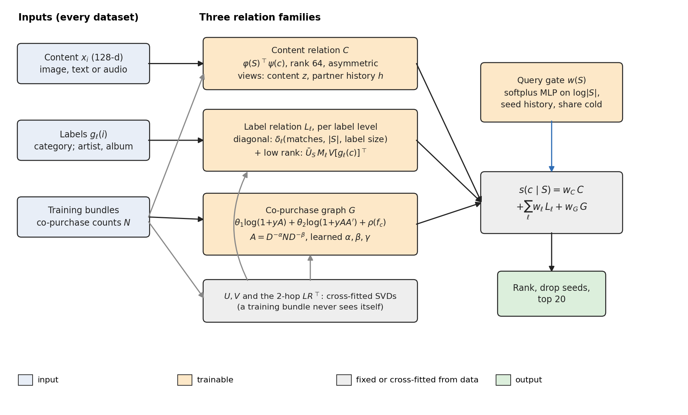
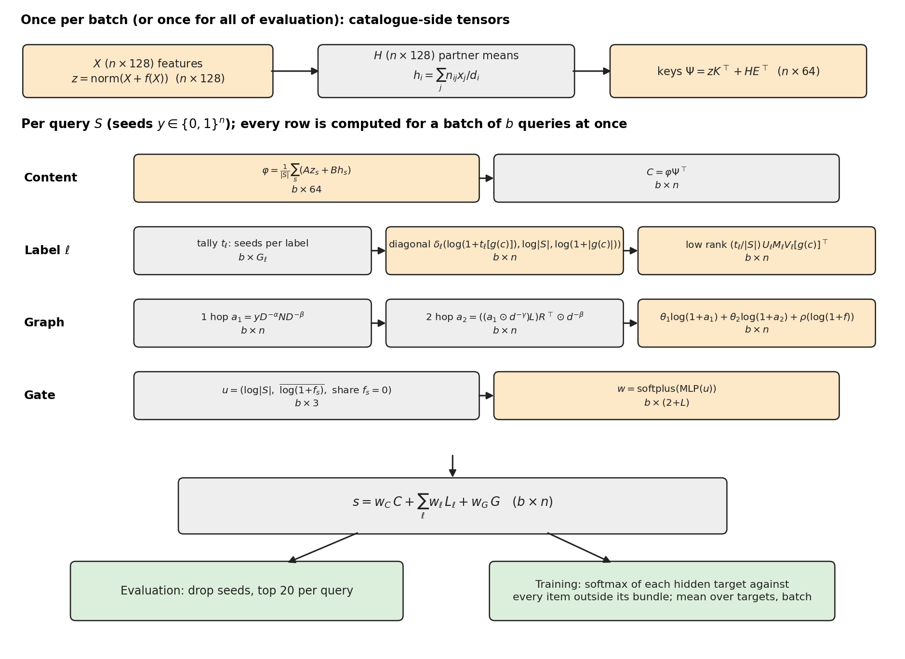
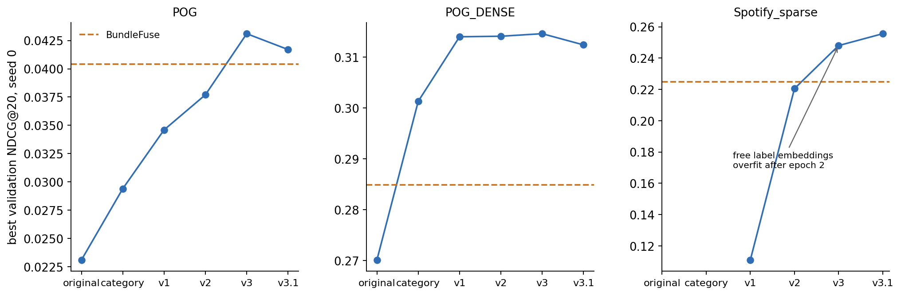
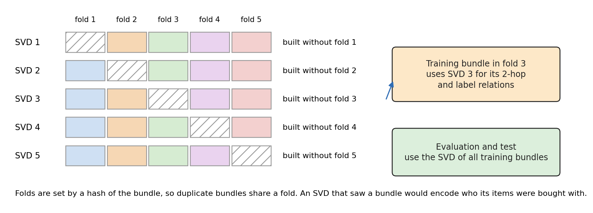
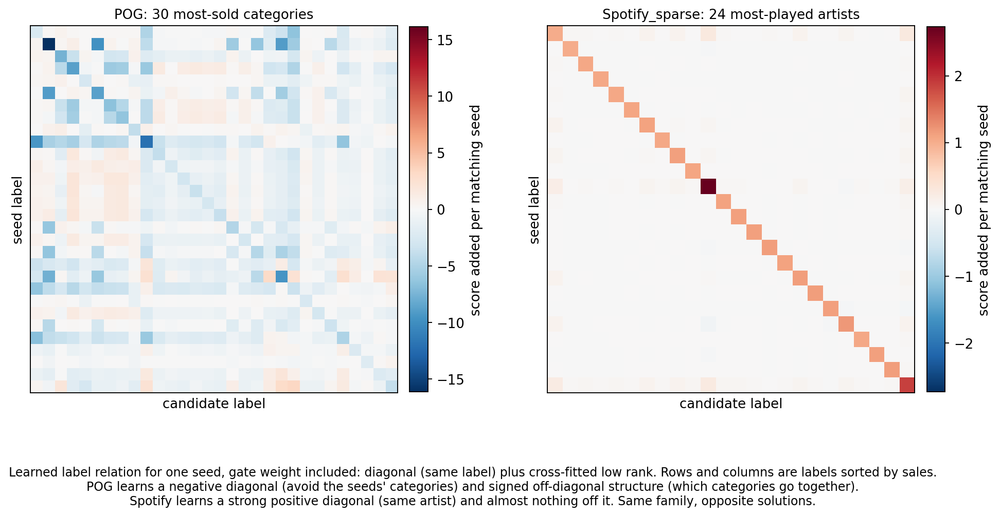
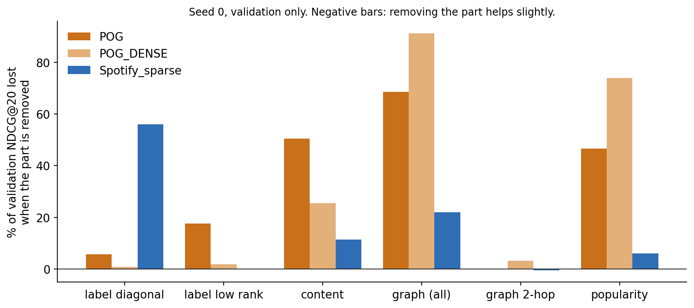

# Relation-family model (v3.1)

Code: [`model.py`](model.py) (`RelationFamily`, `label_mode='spectral'`) and [`run.py`](run.py). The training loop is `fit` in [`../neural_lowrank/run.py`](../neural_lowrank/run.py). The test plan in `results/neural_relations/plan.json` was fixed before any v3.1 test query was scored. Figures come from [`figures/make_figures.py`](figures/make_figures.py), and the learned values plotted are read from the seed 0 checkpoints.

Earlier versions: v1 is described in [`../neural_lowrank/ARCHITECTURE.md`](../neural_lowrank/ARCHITECTURE.md), and the original baseline in [`../neural_revision/ARCHITECTURE.md`](../neural_revision/ARCHITECTURE.md).

**In one line:** the model is not told which relations matter for a dataset. It has one family for each kind of evidence (what an item is, what it is labelled, what it was bought with), each wide enough to express every relation seen so far, and it learns which members to use.

$$
s(c\mid S)\;=\;w_C(S)\,C(S,c)\;+\;\sum_{\ell=1}^{\Lambda}w_\ell(S)\,L_\ell(S,c)\;+\;w_G(S)\,G(S,c)
$$



*Figure 1. Three relation families and a query gate. Orange parts are trained; grey parts are fixed, or computed from training data with cross-fitting.*

---

## 1. Notation

**Sets and indices**

| Symbol | Meaning |
|---|---|
| $n$ | Number of catalogue items. All items are scored, including those never sold in training |
| $i, j, c, s, p$ | Item indices. $c$ is a candidate, $s$ a seed, $p$ an intermediate item on a two-hop path |
| $\mathcal{T}$ | Training bundles: a list of item sets, duplicates kept |
| $S$ | The query's seeds: the items already in the bundle, as a set of unique ids |
| $T$ | The query's hidden targets, known only in training and for scoring metrics |
| $\beta_q = S\cup T$ | The complete training bundle a training query was cut from |
| $y\in\{0,1\}^n$ | Seed indicator, with $y_s=1$ for $s\in S$ |
| $b$ | Number of queries in a batch (32) |
| $\Lambda$ | Number of label levels: 1 on POG (category), 2 on Spotify (artist, album) |
| $\ell$ | A label level. $g_\ell(i)$ is item $i$'s label at that level, $G_\ell$ the number of labels |
| $k$ | Fold index, $k\in\{1,\dots,5\}$ |

**Statistics computed from training bundles** (no parameters)

| Symbol | Shape | Definition |
|---|---|---|
| $N$ | $n\times n$, sparse, symmetric | $n_{ij}$ = number of training bundles containing both $i$ and $j$ ($i\neq j$); diagonal 0 |
| $f$ | $n$ | $f_i$ = number of training bundles containing $i$ (frequency) |
| $d$ | $n$ | $d_i=\sum_j n_{ij}$, the pair mass (degree); $D=\mathrm{diag}(\max(d,1))$ |
| $H$ | $n\times128$ | Partner history: $h_i=\sum_j n_{ij}x_j/d_i$, or $0$ if $d_i=0$ |
| $\lvert g\rvert$ | per label | Number of catalogue items carrying label $g$ |
| $L, R$ | $n\times64$ each | Graph factors with $LR^{\top}\approx N$ (section 2.4) |
| $U_\ell, V_\ell$ | $G_\ell\times16$ each | Label factors of level $\ell$ (section 2.4) |
| $L^{(k)},R^{(k)},U^{(k)}_\ell,V^{(k)}_\ell$ | same | The same factors built without fold $k$ |

**Learned parameters**

| Symbol | Shape | Role | Initial value |
|---|---|---|---|
| $f(\cdot)$ | $128\to32\to128$, GELU | Content encoder | Last layer zero, so $f=0$ |
| $A, K$ | $64\times128$ | Query and key projections of content | $\sqrt{10}\,[I_{64}\ 0]$, the first 64 SVD directions |
| $B, E$ | $64\times128$ | Query and key projections of partner history | $0$ |
| $M_\ell$ | $16\times16$ per level | Mixing of the label factors | $0$ |
| $\delta_\ell(\cdot)$ | $3\to16\to1$, GELU | Same-label score | PyTorch default |
| $\alpha,\beta,\gamma$ | scalars | Degree exponents | $0$ (raw counts) |
| $\theta_1,\theta_2$ | scalars | Weights of the first and second hop | $1, 0$ |
| $\rho(\cdot)$ | $1\to16\to1$, GELU | Popularity curve | PyTorch default |
| gate MLP | $3\to16\to(2+\Lambda)$, GELU, softplus | Per-query family weights | Last layer weights 0, bias $\log(e-1)$, so every $w=1$ |

---

## 2. Inputs

### 2.1 Catalogue inputs, available for every item

| | POG, POG_DENSE | Spotify_sparse, Spotify |
|---|---|---|
| Released feature files | `title_emb.npy` (512-d, provenance undocumented), `content_feature.pt` (768-d, image), `description_feature.pt` (768-d, text) | `content_feature.pt` (512-d, audio) |
| Labels | Category (`cate` in `item_info.json`) | Artist (`artist_uri`), album (`album_uri`) |

**Feature projection to $X\in\mathbb{R}^{n\times128}$.** This happens once, before training, and uses no bundle data:
1. L2-normalize each feature file row by row.
2. Concatenate the files (2,048 dimensions on POG, 512 on Spotify) and L2-normalize again.
3. Apply a truncated SVD to 128 dimensions (randomized, 5 iterations, seed 0).
4. L2-normalize the rows. The columns of $X$ are ordered by explained variance.

### 2.2 History input: training bundles

$\mathcal{T}$ comes from the supplied training split. Everything in the statistics table above is computed from it once per run, then rebuilt (not stored) whenever a checkpoint is loaded.

### 2.3 Query input

- **At evaluation:** the seed list $S$.
- **In training:** each training bundle with at least two items is split at random into seeds $S$ and hidden targets $T$. With probability ½ the split is half and half; otherwise the number of seeds is uniform on $1,\dots,|\beta|-1$. The complete bundle $\beta_q$ is also passed in, for leave-one-out.

### 2.4 Low-rank factors, cross-fitted

**Graph.** Take a rank-64 randomized SVD of the degree-normalized matrix, then undo the normalization so that $LR^{\top}\approx N$:

$$
D^{-1/2}ND^{-1/2}\approx U\Sigma V^{\top},\qquad L=D^{1/2}U\Sigma,\quad R=D^{1/2}V
$$

**Labels.** Let $\Gamma_\ell\in\{0,1\}^{n\times G_\ell}$ map items to labels. The label-by-label co-purchase matrix is $C_\ell=\Gamma_\ell^{\top}N\Gamma_\ell$, with $C_\ell[a,b]$ the number of co-purchased item pairs across labels $a$ and $b$. With $D_\ell$ its degree matrix, take a rank-16 SVD:

$$
D_\ell^{-1/2}C_\ell D_\ell^{-1/2}\approx \tilde U\tilde\Sigma\tilde V^{\top},\qquad U_\ell=\tilde U\tilde\Sigma^{1/2},\quad V_\ell=\tilde V\tilde\Sigma^{1/2}
$$

**Folds.** A bundle's fold is `md5(sorted unique ids) mod 5`, so identical bundles always share a fold. For each fold $k$, the factors are rebuilt from the bundles outside fold $k$. That gives six sets per run, cached on disk by a hash of the training rows and labels.

| Dataset | $n$ | Training bundles | Labels per level | Mean seeds / targets (validation) |
|---|---:|---:|---|---|
| POG | 48,676 | 14,000 | 72 categories | 1.5 / 2.1 |
| POG_DENSE | 31,217 | 20,780 | 67 categories | 2.0 / 1.6 |
| Spotify_sparse | 213,325 | 8,740 | 43,039 artists; 98,674 albums | 21.8 / 21.7 |
| Spotify | 254,155 | 14,000 | 49,164 artists; 116,217 albums | 31.3 / 31.8 |

---

## 3. Forward pass



*Figure 2. One batch of $b$ queries. Every family produces a $b\times n$ score matrix. The gate weights them, and the sum is ranked or trained on.*

### 3.1 Evaluation (one query $S$)

**Step 1: catalogue tensors**, computed once for the whole evaluation and cached:

$$
z_i=\frac{x_i+f(x_i)}{\lVert x_i+f(x_i)\rVert},\qquad \psi_c=Kz_c+Eh_c\in\mathbb{R}^{64}
$$

**Step 2: content relation**

$$
\varphi(S)=\frac{1}{|S|}\sum_{s\in S}\big(Az_s+Bh_s\big),\qquad C(S,c)=\varphi(S)^{\top}\psi_c
$$

**Step 3: label relations**, for each level $\ell$. First count the seeds per label, $t_\ell[a]=\#\{s\in S: g_\ell(s)=a\}$, and let $m=t_\ell[g_\ell(c)]$ be the number of seeds sharing $c$'s label. Then

$$
L_\ell(S,c)=\delta_\ell\big(\log(1+m),\ \log|S|,\ \log(1+|g_\ell(c)|)\big)\cdot[m>0]\;+\;\Big(\tfrac{t_\ell^{\top}}{|S|}U_\ell\Big)\,M_\ell\,V_\ell[g_\ell(c)]^{\top}
$$

The first term is the diagonal, scored only when some seed shares $c$'s label. The second is the low-rank relation between the seeds' label distribution and $c$'s label.

**Step 4: co-purchase graph**

$$
a_1[c]=\sum_{s\in S} n_{sc}\,d_s^{-\alpha}\,d_c^{-\beta}\qquad\text{(exact, over each seed's partners)}
$$

$$
a_2=\big((a_1\odot d^{-\gamma})\,L\big)R^{\top}\odot d^{-\beta}\qquad\text{(low rank: }\textstyle\sum_p a_1[p]\,d_p^{-\gamma}\,n_{pc}\,d_c^{-\beta}\text{)}
$$

$$
G(S,c)=\theta_1\log(1+a_1[c])+\theta_2\log\big(1+\max(a_2[c],0)\big)+\rho\big(\log(1+f_c)\big)
$$

Here $d$ means $\max(d,1)$. The first hop needs no matrix product, because it visits only the seeds' rows of $N$.

**Step 5: gate**

$$
u(S)=\Big(\log|S|,\ \tfrac{1}{|S|}\textstyle\sum_s\log(1+f_s),\ \tfrac{1}{|S|}\#\{s: f_s=0\}\Big),\qquad (w_C,w_1,\dots,w_\Lambda,w_G)=\mathrm{softplus}\big(\mathrm{MLP}(u)\big)
$$

**Step 6: score and rank.** Compute $s(c\mid S)=w_C C+\sum_\ell w_\ell L_\ell+w_G G$ for all $n$ items, drop the seeds, and return the top 20.

### 3.2 Training (one query cut from bundle $\beta$)

The forward pass is the same, with every history statistic replaced by its value without bundle $\beta$. That is what a model fitted without $\beta$ would compute, so training matches test conditions.

| Quantity | Value used for training query $\beta$ |
|---|---|
| Pair count $n_{sc}$, both in $\beta$ | $n_{sc}-1$ |
| Frequency $f_i$, $i\in\beta$ | $f_i-1$, in the popularity curve and the gate |
| Degree $d_i$, $i\in\beta$ (first hop) | $d_i-(|\beta|-1)$ |
| Partner history $h_i$, $i\in\beta$ | $\big(d_i h_i-\sum_{j\in\beta,j\neq i}x_j\big)/\big(d_i-(|\beta|-1)\big)$, or $0$ if no mass is left. It is applied to the seeds in $\varphi$ and, as a correction, to the bundle's items in $\psi$ |
| Graph factors $L,R$ | $L^{(k)},R^{(k)}$, where $k$ is $\beta$'s fold |
| Label factors $U_\ell,V_\ell$ | $U^{(k)}_\ell,V^{(k)}_\ell$ |
| Labels, content features | Unchanged: they are catalogue data, not history |

The second hop's degree normalizers $d^{-\gamma}, d^{-\beta}$ use full training degrees; this is the one approximation. A unit test checks that, with the cross-fitted parts switched off, a leave-one-out score equals the score of a model rebuilt without that bundle (`tests/test_neural_lowrank.py`).

**Loss.** For each hidden target $g\in T$, every item outside the complete bundle is a negative; the seeds and the other targets are excluded:

$$
\mathcal{L}(S)=\frac{1}{|T|}\sum_{g\in T}-\log\frac{e^{s(g\mid S)}}{e^{s(g\mid S)}+\sum_{i\notin\beta}e^{s(i\mid S)}},\qquad \text{averaged over the batch}
$$

There is no negative sampling: the denominator runs over the whole catalogue.

**Optimization**

| Setting | Value |
|---|---|
| Optimizer | AdamW, weight decay .001, gradient clipping at norm 5 |
| Learning rate .01 | $M_\ell$, $\delta_\ell$, $\alpha,\beta,\gamma$, $\theta$, $\rho$, gate |
| Learning rate .001 | Encoder $f$, $A, K, B, E$ |
| Batch | 32 bundles, shuffled each epoch; bundles with fewer than 2 items skipped |
| Epoch selection | Validation NDCG@20 after every epoch. Keep the best, stop after 6 evaluations without improvement, at most 100 epochs |
| Determinism | `torch.use_deterministic_algorithms(True)`; seeded PyTorch and NumPy generators |

The earlier 25% random history mask is not used. Leave-one-out already makes an item seen in only one bundle look never-sold, at roughly the data's own rate. On Spotify_sparse, the mask weakened the co-purchase evidence.

---

## 4. Why each part is there

Each earlier version failed in a way that showed a relation the model couldn't express:

| Version | What failed | What it showed |
|---|---|---|
| Original | Symmetric similarity; no categories | POG targets are almost never in a seed's category, so "looks like" is the wrong relation |
| v1 | Spotify validation NDCG .111 against BundleFuse's .225 | A rank-16 artist table can't express "same artist", because the identity matrix is full rank. Hence the diagonal $\delta_\ell$ |
| v2 | Fixed with hand-written match and popularity terms | Works, but someone must know which relation to add for each dataset. Hence families the model chooses from |
| v3 (first run) | Training loss far below validation | An SVD built on all training bundles encodes each bundle. Hence cross-fitting |
| v3 | Free label embeddings ($U,V$ learned) overfit on Spotify after about 550 steps | One free vector per artist memorizes its few playlists. Hence $U,V$ from data, with only $M_\ell$ learned |



*Figure 3. Best seed-0 validation NDCG@20 for each version; the dashed line is BundleFuse's recipe selection score. These are development numbers on validation, used to choose the design, so they are optimistic.*

**What each family can express:**

- **Content.** $A\neq K$ makes the relation asymmetric ("goes with" rather than "looks like"). $z_c$ needs no history, so this works for never-sold candidates. $B h_s$ and $E h_c$ add a "resembles the seed's usual partners" term: within-category style, without being told what a category is.
- **Label diagonal.** Positive means "same label is evidence for", as with artists; negative means "evidence against", as with categories in an outfit. It scales with the number of matching seeds and the label's size.
- **Label low rank.** Which labels go together, such as tops with skirts. $U_\ell, V_\ell$ come from co-purchase, so they carry no parameters to memorize with.
- **Graph.** $\alpha=\beta=0$ is a raw co-purchase sum, and positive values discount popular items, roughly as PPMI does. $\theta_2$ decides whether partners-of-partners count, and $\rho$ is popularity.
- **Gate.** For example, it can trust the graph when the seeds have been sold before and trust labels or content when they haven't.



*Figure 4. Five SVDs, each blind to one fold. A training bundle in fold $k$ uses SVD $k$; evaluation uses the SVD of all training bundles.*

---

## 5. What it learned

Seed 0, validation queries only (`results/neural_relations/<dataset>/v31_loo_seed0/inspect.json`):

| | POG | POG_DENSE | Spotify_sparse |
|---|---|---|---|
| Same-label diagonal $\times$ gate, one matching seed | ≈ −2 (avoid) | ≈ −9.5 (avoid) | ≈ +3.9 artist, +1.0 album |
| Degree exponents $\alpha,\beta$ | .26, .28 (discount popular) | .34, .37 | −.06, −.08 (raw counts) |
| Second-hop weight $\theta_2$ | −4.0 (no effect in ablation) | −3.1 (helps) | .03 (unused) |
| Mean gate $w_C, w_1, w_2, w_G$ | 4.97, 13.25, –, 3.51 | 7.01, 14.83, –, 4.64 | 3.48, 1.05, 1.24, .72 |



*Figure 5. The learned label relation for one seed, including the gate weight, with labels sorted by sales. Same model, same family, opposite solutions.*



*Figure 6. Share of validation NDCG@20 lost when one part is switched off in the trained model. Parts were trained together, so these overstate what a model retrained without the part would lose.*

Read together:

- **POG** relies on content, the graph and popularity, and on the low-rank category relation, which is cross-category lift. Removing that relation costs 18%.
- **POG_DENSE** relies mostly on the graph and popularity, which fits a dataset where most items have history.
- **Spotify_sparse** relies on the same-label diagonal, losing 56% without it, and makes no use of the low-rank part.

These are the structures BundleFuse encodes by hand: between-category lift and within-category style on POG, artist and album homophily on Spotify. Here one model, identical across datasets, arrived at them from data. That's a stronger argument for the theory's generality than any single dataset's accuracy.

---

## 6. Size and cost

| Component | Parameters |
|---|---:|
| Content encoder $f$ | 8,352 |
| $A, K, B, E$ | 32,768 |
| $M_\ell$ | 256 per level |
| $\delta_\ell$ | 81 per level |
| $\alpha,\beta,\gamma,\theta_1,\theta_2$ and $\rho$ | 54 |
| Gate | 115 ($\Lambda=1$) or 132 ($\Lambda=2$) |
| **Total** | **41,626** (POG, POG_DENSE); **41,980** (Spotify) |

The parameter count doesn't depend on the catalogue, pairs or labels. Data structures do: the rebuilt statistics and six SVDs take 0.13–0.20 GB on POG and about 2 GB on Spotify, and checkpoints store parameters only. One training batch takes about 0.2 seconds on POG_DENSE and about 2 seconds on Spotify, on 3 CPU threads.

| Dataset | Original neural | Category model | v1 | v3 | **v3.1** |
|---|---:|---:|---:|---:|---:|
| POG | 163,011 | 168,195 | 45,553 | 43,674 | **41,626** |
| Spotify | 67.2M (never run) | ≈2.5B (never run) | 1.62M | 5.33M | **41,980** |

---

## 7. Remaining limits

- **Still linear in the seeds.** $\varphi(S)$ is a mean, and the label and graph terms add per-seed evidence. Nothing models "A and B together suggest C".
- **The second hop is approximate.** A rank-64 SVD of a graph with tens of millions of pairs keeps only its broad structure, and its degree normalizers use full training degrees.
- **Only one content view.** The modalities are merged into one 128-d projection, so the model can't weight image against text separately.
- **Development used the same validation queries,** from v1 to v3.1, on POG, POG_DENSE and Spotify_sparse. The plan therefore treats the test as exploratory. Full Spotify was never used in development.
- **Inputs overlap with BundleFuse's.** Co-purchase counts, frequencies and labels are the same raw statistics BundleFuse builds its signals from, though no BundleFuse score, weight or selection enters training.

## 8. Status

Frozen on 2026-11-08 (`results/neural_relations/plan.json`):
- **Seeds:** 0–2 on POG, POG_DENSE, Spotify_sparse and Spotify.
- **Comparisons:** filtered test queries, compared with BundleFuse on all four datasets and with the category model on the two POG datasets.
- **Statistics:** NDCG@20 and Recall@20, Holm-corrected together.

### Test result (`results/neural_relations/summary.json`)

The test ran once, after every seed had finished. The amendments in `plan.json` record two test-step bug fixes: matching a duplicated test bundle in the Spotify_sparse reference, and reporting `null` instead of NaN. No model was retrained.

Filtered test queries, three-seed per-query means, Recall@20 / NDCG@20:

| Dataset | v3.1 | BundleFuse | Category model |
|---|---|---|---|
| POG_DENSE | **.3797 / .2805** | .3600 / .2580 | .3663 / .2669 |
| POG | .0591 / .0353 | .0535 / .0352 | .0434 / .0275 |
| Spotify_sparse | **.1815 / .2548** | .1540 / .2216 | – |
| Spotify | **.1692 / .2865** | .1549 / .2570 | – |

Primary tests, Holm correction over 12:

| Dataset | v3.1 minus | NDCG@20 difference (95% CI) | Holm p | Recall@20 difference | Holm p |
|---|---|---|---:|---|---:|
| POG_DENSE | BundleFuse | **+.0225** (+.0191, +.0259) | .0012 | +.0197 | .0012 |
| POG_DENSE | Category model | +.0136 (+.0108, +.0165) | .0012 | +.0134 | .0012 |
| POG | BundleFuse | .0000 (−.0030, +.0032) | .98 | +.0056 | .06 |
| POG | Category model | +.0078 (+.0053, +.0104) | .0012 | +.0157 | .0012 |
| Spotify_sparse | BundleFuse | **+.0332** (+.0290, +.0377) | .0012 | +.0275 | .0012 |
| Spotify | BundleFuse | **+.0295** (+.0250, +.0339) | .0012 | +.0143 | .0012 |

Under the fixed decision rule:
- **Ahead of BundleFuse** on POG_DENSE, Spotify_sparse and Spotify. Spotify was never used in development.
- **Not separated from BundleFuse on POG.** The NDCG difference is 0, which is not the same as equivalence.
- **Ahead of the category model** on both POG datasets.

Seed spread on filtered NDCG@20: POG_DENSE .2780–.2823, POG .0336–.0364, Spotify_sparse .2542–.2554, Spotify .2840–.2896.

Caveats:
- **The reference is the publication recipe.** On POG, a later BundleFuse replay with matched settings (block-control parity) scored .0400 filtered NDCG, which would put v3.1 behind on POG.
- **The POG results are exploratory.** The design was developed on the same validation queries and the POG splits had been inspected before.
- **Spotify_sparse uses a different reference:** the general_lift recipe refit, available only for filtered queries.

### E-commerce transfer and simple baselines

**E-commerce.** v3.1 was frozen and run unchanged on Electronic, Food and Clothing, which were never used in its development, under `results/neural_retail/plan.json`. It was also compared on all seven datasets with standard non-neural baselines, each tuned on validation (`results/simple_baselines`):
- popularity, co-occurrence, ItemKNN, RP3β and GF-CF everywhere
- EASE except on the two Spotify datasets, which have more than 160,000 trained items, too many for its dense inverse

Full test set, Recall@20 / NDCG@20; v3.1 is the three-seed mean:

| Dataset | v3.1 | Best simple baseline, chosen on validation | Published RaMen | CLHE |
|---|---|---|---|---|
| POG | **.0598 / .0360** | EASE .0305 / .0207 | .0375 / .0226 (same split files) | .0275 / .0184 (our rerun) |
| POG_DENSE | **.4121 / .3102** | RP3β .3826 / .2759 | – | .3815 / .2771 (our rerun) |
| Spotify_sparse | **.1818 / .2551** | RP3β .1183 / .1491 | – | .0969 / .1150 (our rerun) |
| Spotify | **.1698 / .2873** | ItemKNN .1307 / .2202 | .1091 / .1882 | .1081 / .1806 (published) |
| Electronic | **.4691 / .3356** | EASE .3535 / .2538 | .8371 / .5373 (different split) | – |
| Food | **.5847 / .4376** | GF-CF .3404 / .2685 | .8459 / .5242 (different split) | – |
| Clothing | **.5338 / .3883** | EASE .2350 / .2009 | – | – |

**v3.1 against the best simple baseline:** ahead on every dataset on both metrics, Holm p ≤ .001 (`results/simple_baselines/comparison.json`, `results/neural_retail/summary.json`). The NDCG@20 margins range from +.0155 on POG (filtered) to +.187 on Clothing.

On never-sold e-commerce targets, v3.1 recalls 25–28% on Electronic, 43–45% on Food and 41–42% on Clothing. Collaborative filtering baselines can't score these items at all.

**Open:**
- **RaMen's e-commerce splits are not public,** and its numbers there are far higher than any model on ours. The gap can't be attributed without running RaMen on our split.
- **Spotify:** a tuned ItemKNN already beats published RaMen and CLHE.

v1, tested under its own plan (`results/neural_lowrank/summary.json`), scored .2801 on POG_DENSE (ahead of BundleFuse) and .0292 on POG (behind BundleFuse, −.0060).

## 9. Reproducing

```sh
.venv/bin/python -m unittest tests.test_neural_lowrank -v
results/neural_relations/frozen.sh                         # frozen seeds
PYTHONPATH=. .venv/bin/python -m experiments.neural_relations.run inspect --dataset pog --tag v31
PYTHONPATH=. .venv/bin/python -m experiments.neural_relations.run test
PYTHONPATH=. .venv/bin/python experiments/neural_relations/figures/make_figures.py --extract
```
