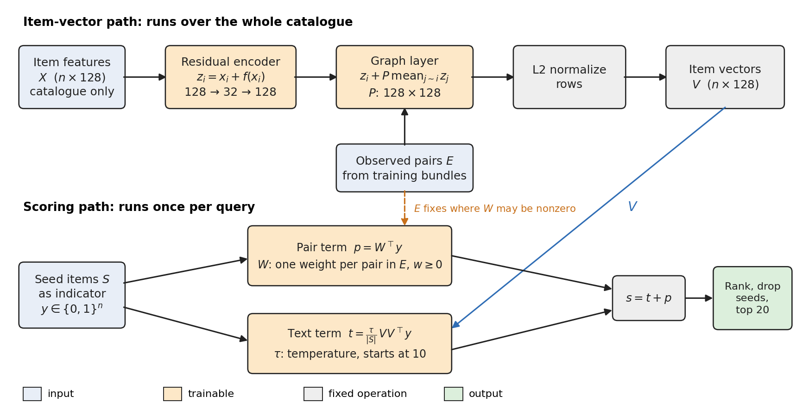
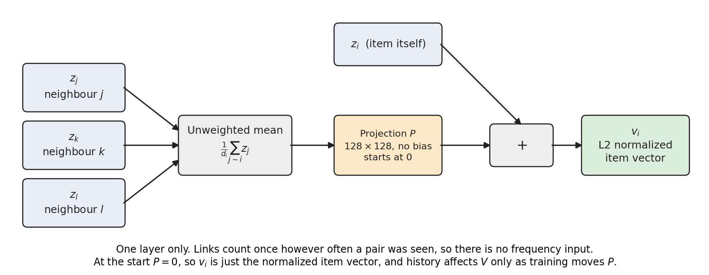
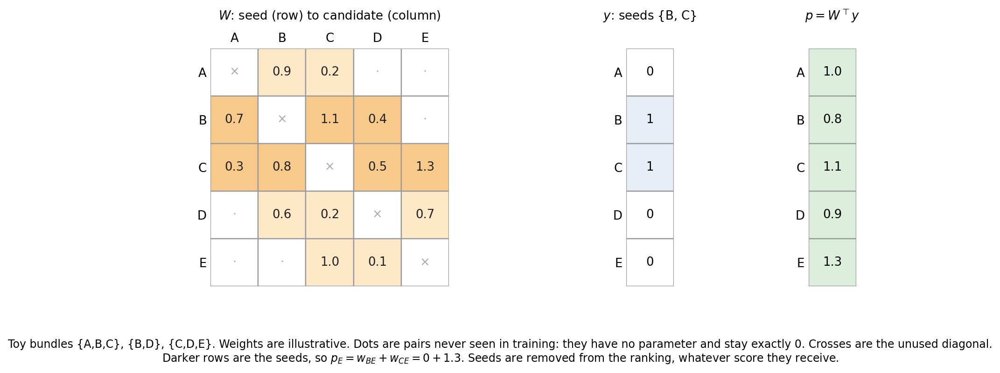
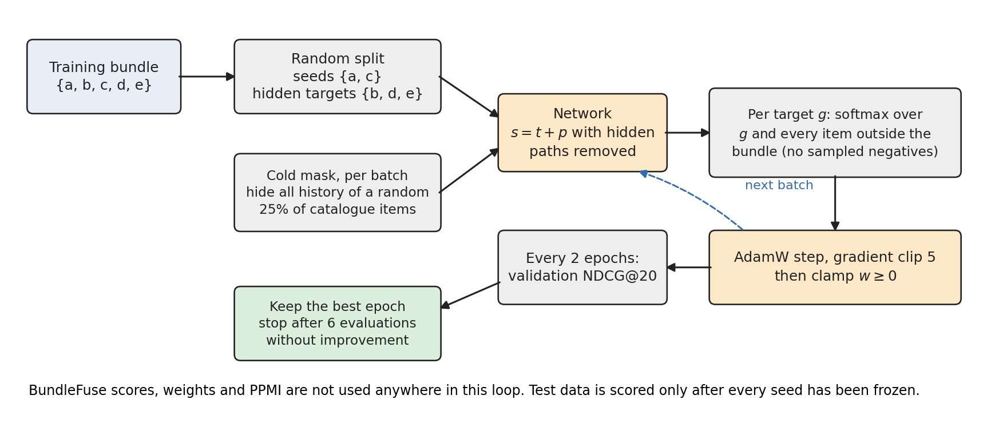

# Neural baseline: `graph_pair_no_category`

This is the model from `experiments/neural_revision`, in the configuration selected on Electronic validation and carried unchanged to Food, Clothing, POG_DENSE and POG. Code: [`model.py`](model.py) (`RelationNetwork`) and [`training.py`](training.py).

**In one line:** the score is a learned item similarity plus a learned table with one weight for every item pair seen in training.

$$
s(S)\;=\;\underbrace{\frac{\tau}{|S|}\,V V^{\top} y}_{\text{text term }t}\;+\;\underbrace{W^{\top} y}_{\text{pair term }p}
$$

Here $y\in\{0,1\}^n$ marks the seed items, $V$ holds one learned unit vector per item, and $W$ is a sparse $n\times n$ matrix of nonnegative weights.



*Figure 1. The top row builds $V$ once for the whole catalogue. The bottom row scores one query.*

## The forward pass, step by step

### 1. Input features: $X\in\mathbb{R}^{n\times128}$

Each item starts as a fixed 128-dimensional vector built from catalogue data only, with no bundle labels.

| Dataset | Source of $X$ |
|---|---|
| Electronic, Food, Clothing | Title TF-IDF, reduced with SVD |
| POG, POG_DENSE | Title, image and description vectors: each normalized, concatenated to 2,048 dimensions, reduced to 128 with SVD |

Rows are then L2-normalized. These projections are not trained.

### 2. Residual encoder: $x_i\mapsto z_i$

$$
z_i = x_i + f(x_i),\qquad f = \text{Linear}(128\to32)\;\circ\;\text{GELU}\;\circ\;\text{Linear}(32\to128)
$$

The last layer starts at zero, so at initialization $z_i=x_i$ and the model begins from plain feature similarity. Training learns a correction. Because $f$ is shared, it also applies to items with no purchase history.

### 3. Graph layer: $z_i\mapsto v_i$

Each item takes the mean of its neighbours' vectors, passes it through a learned matrix $P$, and adds it to its own vector:

$$
v_i=\frac{z_i+P\,\frac{1}{d_i}\sum_{j\sim i} z_j}{\left\lVert z_i+P\,\frac{1}{d_i}\sum_{j\sim i} z_j\right\rVert_2}
$$

Item $j$ is a neighbour of $i$ if they appeared together in at least one training bundle, and $d_i$ is the number of neighbours. Stacking the $v_i$ gives $V\in\mathbb{R}^{n\times128}$.



*Figure 2. One round of message passing for item $i$.*

$P$ starts at zero, so history enters $V$ only as training moves $P$. An item with no neighbours keeps $v_i=z_i/\lVert z_i\rVert$.

### 4. Text term: $t$

$$
t_c=\tau\cdot\frac{1}{|S|}\sum_{s\in S} v_s^{\top}v_c
$$

This is the mean cosine similarity between the candidate and the seeds, scaled by a learned temperature $\tau$. It starts at 10 and is capped at 100. Despite the code's name, on POG the vectors also carry image and description information.

### 5. Pair term: $p$

$$
p_c=\sum_{s\in S} w_{sc}
$$

There is one free weight for each directed pair seen in training, starting at zero. Pairs never seen in training have no parameter, so their contribution is always exactly zero. After every optimizer step, weights are clamped so that $w\geq0$.



*Figure 3. The pair term is a sparse matrix-vector product.*

### 6. Score and ranking

$s=t+p$ for every catalogue item. Seeds are removed, and the top 20 are returned.

## How it is trained



*Figure 4. One training step and the outer selection loop.*

**Masked bundles.** Each training bundle is randomly split into seeds and hidden targets. Half the time the split is about half and half; otherwise the seed count is random.

**Simulated cold items.** In every batch, a random 25% of catalogue items lose all history: their pair weights and graph messages are removed, while their features stay. The network isn't told which items were hidden. The mask is off at inference.

**Loss.** Each hidden target $g$ competes against every item outside the complete bundle, with no negative sampling. Other positives and the seeds are excluded:

$$
\mathcal{L}_g=-\log\frac{e^{s_g}}{e^{s_g}+\sum_{i\notin\text{bundle}}e^{s_i}}
$$

Losses are averaged over a query's targets, then over the batch.

| Setting | Value |
|---|---|
| Optimizer | AdamW, weight decay .001 |
| Learning rate | .03 for $W$, .001 for everything else |
| Batch size | 32 |
| Gradient clipping | Norm 5 |
| Maximum epochs | 100 |
| Checkpoint selection | Validation NDCG@20 every 2 epochs |
| Early stopping | After 6 evaluations without improvement |
| Training seeds | 3 |

## Size

Everything except $W$ has a fixed size of 24,737 parameters, so model size is set by how many pairs a dataset has.

| Component | Shape | Parameters |
|---|---|---:|
| Encoder, first layer | $128\to32$ with bias | 4,128 |
| Encoder, second layer | $32\to128$ with bias | 4,224 |
| Graph projection $P$ | $128\times128$, no bias | 16,384 |
| Temperature | Scalar | 1 |
| **Fixed subtotal** | | **24,737** |

| Dataset | Pair weights $W$ | Total trainable | Share in $W$ |
|---|---:|---:|---:|
| Clothing | 12,666 | 37,403 | 34% |
| Food | 13,724 | 38,461 | 36% |
| Electronic | 13,788 | 38,525 | 36% |
| POG | 138,274 | 163,011 | 85% |
| POG_DENSE | 153,074 | 177,811 | 86% |
| Spotify_sparse (not run) | 27,319,480 | 27,344,217 | 99.9% |
| Spotify (not run) | 67,163,986 | 67,188,723 | 99.96% |

The two Spotify rows are computed from pair counts in the training data, assuming the same 128-dimensional input.

## What kind of model this is

- **Scores are linear in the seeds.** Apart from the $1/|S|$ factor on $t$, each seed adds its own contribution and nothing depends on seed combinations. The model can't represent "A and B together suggest C" unless A and B separately point to C. A joint-seed term was tested on Electronic, and it did not win validation.
- **Its pair term is close to a learned co-occurrence table.** $W$ has the same sparsity pattern as a co-occurrence matrix, but its values come from gradient descent instead of counts.
- **Depth is small.** The only nonlinearity is one GELU in $f$, plus the normalization. The model has one graph layer, and no attention or item-ID embeddings.
- **History is not compressed.** Earlier embedding models forced pair information through low-dimensional vectors, and this model avoids that by giving each pair its own weight. That likely explains much of why it does better than those models, though no controlled comparison has isolated it.

## What it uses and leaves out

| Input or mechanism | This model | Note |
|---|---|---|
| Catalogue features | Yes | Combined into one 128-dimensional projection |
| Training bundles | Yes | Through $W$ and the graph |
| Categories, artists, albums | **No** | A category table exists in the code but is switched off, because the unconstrained version hurt Electronic validation |
| Item frequency as an input | No | An earlier version had it and was dropped |
| Item-ID embeddings | No | |
| BundleFuse scores, weights, PPMI or teacher labels | No | Nothing from BundleFuse enters training; its scores are only used in comparison and separate diagnostics |

Leaving out categories is the most consequential choice. It means the model has no direct route to the group signals BundleFuse uses, such as category lift on POG or artist-level signals on Spotify.

## Results so far

**Electronic, Food and Clothing, full test set (Recall@20 / NDCG@20).** Neural figures are means over three seeds.

| Dataset | Neural | BundleFuse, no auxiliary signals | BundleFuse with auxiliary signals |
|---|---|---|---|
| Electronic | .4579 / .3298 | .4605 / .3442 | .4868 / .3432 |
| Food | .5637 / .4408 | .5751 / .4493 | .5949 / .4624 |
| Clothing | .5035 / .3798 | .4747 / .3888 | .5169 / .4049 |

So the model is close to the version without auxiliary signals and behind on every cell against the version with them. These splits had already been inspected, so the results are exploratory.

**POG_DENSE and POG: stopped before completion.** The run was stopped on request with seed 2 unfinished on both datasets, so **no test scores exist**. Validation NDCG@20 at the point it stopped:

| Dataset | Seed 0 | Seed 1 | Seed 2 (best so far) | BundleFuse (recipe selection score) |
|---|---:|---:|---:|---:|
| POG_DENSE | .2701 | .2710 | .2726 | .2849 |
| POG | .0231 | .0238 | .0224 | .0404 |

Both validation columns were used for selection, and I haven't confirmed that BundleFuse's stored value covers exactly the same queries, so treat this as a rough comparison.

## Known limitations

- **Training is easier than testing for $W$.** During training, a seed's pair to its target almost always has a weight, since both came from the same bundle, unless the cold mask hides it. On test queries, many such pairs were never observed. The 25% mask only partly simulates this.
- **Architecture transfer is untuned.** Settings were chosen on Electronic, which has about 14,000 pairs. A poor POG result wouldn't rule out better settings.
- **Spotify doesn't fit as written.** Its 27 million and 67 million pair weights exceed practical limits for the current pair step, per-batch graph step and per-epoch checkpoints on this machine. Those limits are estimates, because no Spotify run has been attempted.
- **The name is generous.** Most of the POG parameters are a lookup table, so calling this a "neural baseline" needs that context beside it.

## Reproducing

```sh
.venv/bin/python -m unittest tests.test_neural_revision -v
PYTHONPATH=. .venv/bin/python -u -m experiments.neural_revision.pog --dataset pog_dense
python experiments/neural_revision/figures/make_figures.py
```

The POG command resumes from the last evaluated epoch in `checkpoints/neural_pog`, as long as the source files are unchanged. Protocol details and the history of earlier revisions are in [`README.md`](README.md).
